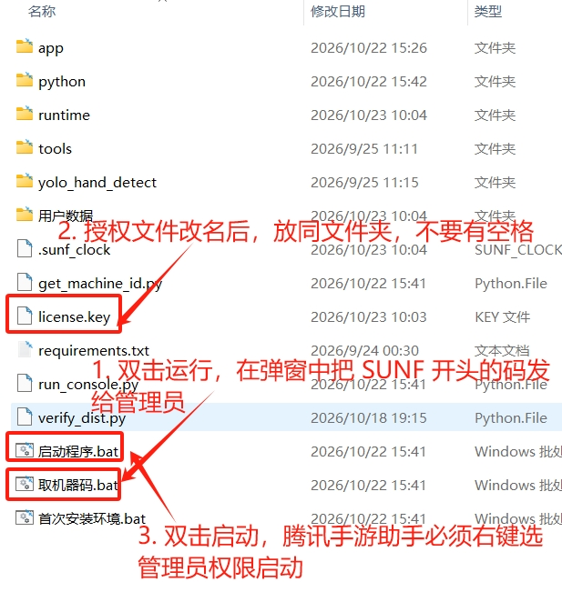
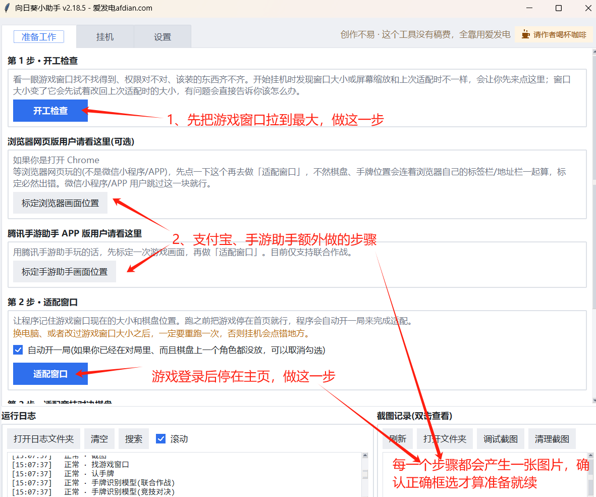
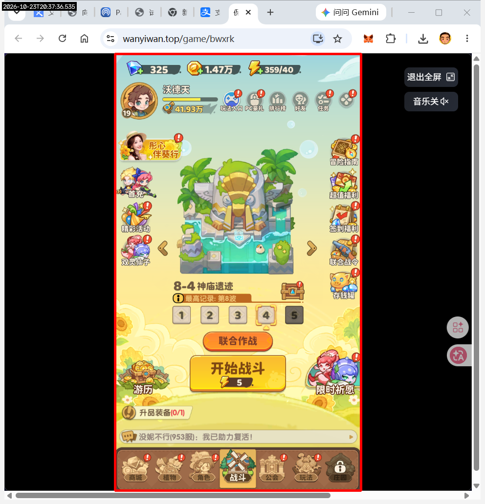
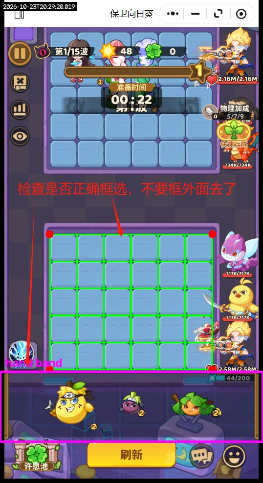

# 新手使用教程

建议在电脑端打开本页面，按下方顺序边看边操作，点击目录可快速跳转到对应步骤。

👉 **[前往下载最新版压缩包](https://github.com/yingke-quant/bwxrk-tutorial/releases/latest)**

> 也可以查看 [图文长图版教程](assets/教程长图.png)，一张图看完全部步骤。

## 目录

1. [下载并解压](#1-下载并解压)
2. [执行第一步](#2-执行第一步)
3. [使用推荐平台/模拟器](#3-使用推荐平台模拟器)
4. [开工检查](#4-开工检查)
5. [窗口适配成功](#5-窗口适配成功)
6. [开始挂机](#6-开始挂机)
7. [常见问题 QA](#常见问题-qa)

---

## 1. 下载并解压

点击上方链接下载最新版压缩包，下载完成后，将压缩包内的全部文件解压出来（**不要只打开压缩包直接运行，务必先解压到一个独立文件夹**）。

## 2. 执行第一步

解压完成后，按图示完成"第一步"操作。

## 3. 使用推荐平台/模拟器

| 游戏端 | 推荐平台 |
| --- | --- |
| 微信小程序 | **腾讯手游助手** |
| 支付宝 | **谷歌浏览器** |
| APP | **腾讯手游助手** |
| 其他端 | 暂未实测 |

> 💡 使用推荐平台出问题的几率更小，兼容更好。

打开浏览器（支付宝端），先点击全屏，再进行下一步操作。

## 4. 开工检查

> ⚠️ **注意：务必核对"标定结果图片"和"适配结果图片"是否正常，确认无误后才能继续。**

下图为开工检查页面示例，以及对应的"浏览器画布标定"示例，供你比对核实。

**开工检查示例**

**浏览器画布标定示例**

## 5. 窗口适配成功

核对无误后，窗口适配成功的效果如下图所示。

## 6. 开始挂机

✅ 以上步骤确认都没问题后，就可以放心去挂机了。

---

## 常见问题 QA

### Q：支持哪些平台？手机、Windows、Mac、鸿蒙系统

目前仅支持 Windows 10 以上操作系统，其他系统正在全力赶工，会陆续开放出来。

### Q：会封号吗？

不会。小助手不是外挂，它的原理是通过游戏截图，识别后进行模版匹配，然后模拟点击和拖拽操作。60多亿战力大佬一样在用。

### Q：支持识别哪些游戏平台？

微信小程序、支付宝（网页）、各种模拟器（腾讯手游助手最佳）都支持，其余模拟器可能要调整参数来适配。

### Q：找不到游戏窗口

小助手是通过窗口标题来找游戏的，点开工检查后，日志区域会提示找到的游戏窗口名有哪些，核对一下真正的名字，然后填写到：**设置 -> 游戏窗口标题** 处。

### Q：mumu 模拟器如何支持（其他模拟器类似）

1. 设置窗口标题，见 QA【找不到游戏窗口】。
2. 在 **设置** 中修改 **运行模式** 为：有鼠标模式。

### Q：支付宝网页不能正确标定窗口

检查支付宝游戏中新界面，有没有点击全屏。

### Q：窗口适配正常，但是挂机不会操作游戏

游戏窗口权限太高，助手权限不够。需要重新在"启动程序"文件右键选择"**以管理员身份运行**"。

### Q：小助手支持多开吗？

不支持，启动多个助手程序会相互覆盖数据，导致每个账号都会出现各种识别不准的问题，甚至直接跑不起来。

### Q：小助手运行中，可以做其他操作吗？

可以，助手通过 PrintWindow 技术实现精准窗口点击，不会占用鼠标和键盘。可以将任何窗口覆盖在游戏窗口上。唯一注意一点：**不能将游戏窗口最小化**（操作系统限制，无法读取游戏画面）。

### Q：不上牌、两种植物互挤、找不到按钮

游戏窗口尺寸太小。将游戏窗口左右两边拉到最大（窗口会等比放大），部分区域超出屏幕也没关系。助手是通过游戏截图识别按钮，按钮或画面尺寸过小无法通过模版识别出来。

### Q：植物皮肤能识别吗？

助手兼容了图鉴中的所有皮肤，一些限定皮肤（不在图鉴中）会无法识别，只需要下掉皮肤就能正确识别了。

### Q：出问题时，如何向管理员提供证据？

一共分 5 步，这样采集最精确：

1. 关闭小助手，将主目录 `runtime` 文件夹全部删除
2. 重启小助手，打开 **设置 -> 调试模式**，然后保存
3. 进入 **准备工作 -> 开工检查**，确认一切就绪
4. 勾选有问题的玩法，点击一键挂机
5. 将 `runtime` 目录整体压缩打包，发给管理员
